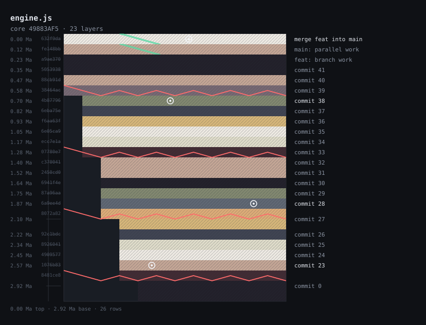

<div align="center">

# strata

### Your files have stratigraphy. You just never dug.

**Every file is a borehole. Every commit is a layer of sediment.**

Read a file's git history as a geological core sample — faults, fossils, dikes and all.

<a href="#install"></a>




</div>

---

```
$ strata engine.js
```

```
◆ ─ engine.js ─ 54E49B1E                      ← the file, and its registry id
   0.00 Ma ▩▩▩▩▩▩▩▩▩▩▩▩╱▩▩▩▩▩▩▩▩▩▩▩ merge feat into main
   0.17 Ma ▚▚▚▚▚▚▚▚▚▚▚▚╱▚▚▚▚▚▚▚▚▚▚▚ main: parallel work
   0.34 Ma ▚▚▚▚▚▚▚▚▚▚▚▚▚▚▚▚▚▚▚▚▚▚▚▚ feat: branch work
   0.52 Ma ▩▩▩▩▩▩▩▩▩▩▩▩▩▩▩▩▩▩▩▩▩▩▩▩ commit 41
   0.69 Ma ▤▤▤▤▤▤▤▤▤▤▤▤▤▤▤▤▤▤▤▤▤▤▤▤ commit 40
╱  0.86 Ma ▒▒▒▒▒▒▒▒▒▒▒▒▒▒▒▒▒▒▒▒▒▒▒▒ commit 39      ← a fault shears the column
   1.03 Ma   ▒▒▒▒▒▒▒▒▒▒▒▒▒▒▒▒▒▒▒▒▒▒               everything below shifts
   1.20 Ma   ░░░░░░░░░░░◌░░░░░░░░░░ commit 38      ← ◌ a fossil: more deleted than added
   1.37 Ma   ██████████████████████ commit 37
   1.55 Ma   ▓▓▓▓▓▓▓▓▓▓▓▓▓▓▓▓▓▓▓▓▓▓ commit 36
   1.72 Ma   ▞▞▞▞▞▞▞▞▞▞▞▞▞▞▞▞▞▞▞▞▞▞ commit 35
   1.89 Ma   ▚▚▚▚▚▚▚▚▚▚▚▚▚▚▚▚▚▚▚▚▚▚ commit 34
╱  2.06 Ma   ▩▩▩▩▩▩▩▩▩▩▩▩▩▩▩▩▩▩▩▩▩▩ commit 0       ← another break
   2.23 Ma     ▩▩▩▩▩▩▩▩▩▩▩▩▩▩▩▩▩▩▩▩
   2.40 Ma     ▩▩▩▩▩▩▩▩▩▩▩▩▩▩▩▩▩▩▩▩
   2.58 Ma     ▩▩▩▩▩▩▩▩▩▩▩▩▩▩▩▩▩▩▩▩
   2.75 Ma     ▩▩▩▩▩▩▩▩▩▩▩▩▩▩▩▩▩▩▩▩
   2.92 Ma     ▩▩▩▩▩▩▩▩▩▩▩▩▩▩▩▩▩▩▩▩ ▼ end of core
```

The depth axis runs from the surface (newest commit, 0.00 Ma) down to bedrock
(the file's first commit). Deeper means older. That is the whole reading.

## Tutorial

### 1. Read your first core

Go to any repository and point `strata` at a file that has been around a while:

```
$ cd path/to/some/repo
$ npx strata src/engine.js
```

```
◆ ─ src/engine.js ─ 49883AF5
   0.00 Ma ▩▩▩▩▩▩▩▩▩▩▩▩╱▩▩▩▩▩▩▩▩▩▩▩ merge feat into main
   0.17 Ma ▚▚▚▚▚▚▚▚▚▚▚▚╱▚▚▚▚▚▚▚▚▚▚▚ main: parallel work
   0.34 Ma ▚▚▚▚▚▚▚▚▚▚▚▚▚▚▚▚▚▚▚▚▚▚▚▚ feat: branch work
   0.52 Ma ▩▩▩▩▩▩▩▩▩▩▩▩▩▩▩▩▩▩▩▩▩▩▩▩ commit 41
   0.69 Ma ▤▤▤▤▤▤▤▤▤▤▤▤▤▤▤▤▤▤▤▤▤▤▤▤ commit 40
╱  0.86 Ma ▒▒▒▒▒▒▒▒▒▒▒▒▒▒▒▒▒▒▒▒▒▒▒▒ commit 39
   1.03 Ma   ▒▒▒▒▒▒▒▒▒▒▒▒▒▒▒▒▒▒▒▒▒▒
   1.20 Ma   ░░░░░░░░░░░◌░░░░░░░░░░ commit 38
   1.37 Ma   ██████████████████████ commit 37
   1.55 Ma   ▓▓▓▓▓▓▓▓▓▓▓▓▓▓▓▓▓▓▓▓▓▓ commit 36
   1.72 Ma   ▞▞▞▞▞▞▞▞▞▞▞▞▞▞▞▞▞▞▞▞▞▞ commit 35
   1.89 Ma   ▚▚▚▚▚▚▚▚▚▚▚▚▚▚▚▚▚▚▚▚▚▚ commit 34
╱  2.06 Ma   ▩▩▩▩▩▩▩▩▩▩▩▩▩▩▩▩▩▩▩▩▩▩ commit 0
   2.23 Ma     ▩▩▩▩▩▩▩▩▩▩▩▩▩▩▩▩▩▩▩▩
   2.40 Ma     ▩▩▩▩▩▩▩▩▩▩▩▩▩▩▩▩▩▩▩▩
   2.58 Ma     ▩▩▩▩▩▩▩▩▩▩▩▩▩▩▩▩▩▩▩▩
   2.75 Ma     ▩▩▩▩▩▩▩▩▩▩▩▩▩▩▩▩▩▩▩▩
   2.92 Ma     ▩▩▩▩▩▩▩▩▩▩▩▩▩▩▩▩▩▩▩▩
   2.92 Ma     ▔▔▔▔▔▔▔▔▔▔▔▔▔▔▔▔▔▔▔▔ ▼ end of core
```

Three things to read off it, in this order:

1. **The left column** — depth. `0.00 Ma` is the newest commit; `2.92 Ma` is the file's first.
   The core is `2.92` million years deep because the file has been alive for 2.92 *years*.
   (One year of real time = one million years of geological time. The scale is fixed.)
2. **The body** — one row per commit, thickness proportional to that commit's churn.
   Blocks that span several rows are the heavy commits.
3. **The markers** — `╱` on the left is a fault, `◌` in the body is a fossil,
   `⌁` cutting a layer vertically is a dike.

### 2. Narrow it down

A 40-row core is hard to read at a glance. Cap it:

```
$ strata --max-rows 8 src/engine.js
```

```
◆ ─ src/engine.js ─ 49883AF5
   0.00 Ma ▒▒▒▒▒▒▒▒▒▒▒▒╱▒▒▒▒▒▒▒▒▒▒▒ merge feat into main
   0.42 Ma ░░░░░░░░░░░░╱░░░░░░░░░░░ main: parallel work
   0.83 Ma ████████████████████████ feat: branch work
   1.25 Ma ▓▓▓▓▓▓▓▓▓▓▓▓▓▓▓▓▓▓▓▓▓▓▓▓ commit 41
   1.67 Ma ▞▞▞▞▞▞▞▞▞▞▞▞▞▞▞▞▞▞▞▞▞▞▞▞ commit 40
╱  2.09 Ma ▚▚▚▚▚▚▚▚▚▚▚▚▚▚▚▚▚▚▚▚▚▚▚▚ commit 39
╱  2.50 Ma   ▩▩▩▩▩▩▩▩▩▩▩▩▩▩▩▩▩▩▩▩▩▩ commit 0
   2.92 Ma     ▩▩▩▩▩▩▩▩▩▩▩▩▩▩▩▩▩▩▩▩
   2.92 Ma     ▔▔▔▔▔▔▔▔▔▔▔▔▔▔▔▔▔▔▔▔ ▼ end of core
```

Fewer rows means neighbouring commits are **merged** into one layer, not discarded — the
churn adds up, so the shape still holds. The registry id stays the same, because identity
is the file plus its first commit, not the view.

### 3. Widen it

Narrow cores make the fault offset hard to see. If you have a wide terminal:

```
$ strata --width 40 --max-rows 5 src/engine.js
```

```
◆ ─ src/engine.js ─ 49883AF5
   0.00 Ma ▓▓▓▓▓▓▓▓▓▓▓▓▓▓▓▓▓▓▓▓╱▓▓▓▓▓▓▓▓▓▓▓▓▓▓▓▓▓▓▓ merge feat into main
   0.73 Ma ▞▞▞▞▞▞▞▞▞▞▞▞▞▞▞▞▞▞▞▞╱▞▞▞▞▞▞▞▞▞▞▞▞▞▞▞▞▞▞▞ main: parallel work
   1.46 Ma ▚▚▚▚▚▚▚▚▚▚▚▚▚▚▚▚▚▚▚▚▚▚▚▚▚▚▚▚▚▚▚▚▚▚▚▚▚▚▚▚ feat: branch work
╱  2.19 Ma ▩▩▩▩▩▩▩▩▩▩▩▩▩▩▩▩▩▩▩▩▩▩▩▩▩▩▩▩▩▩▩▩▩▩▩▩▩▩▩▩ commit 0
   2.92 Ma   ▩▩▩▩▩▩▩▩▩▩▩▩▩▩▩▩▩▩▩▩▩▩▩▩▩▩▩▩▩▩▩▩▩▩▩▩▩▩
   2.92 Ma   ▔▔▔▔▔▔▔▔▔▔▔▔▔▔▔▔▔▔▔▔▔▔▔▔▔▔▔▔▔▔▔▔▔▔▔▔▔▔ ▼ end of core
```

### 4. Strip the labels

For a screenshot, or to paste into a doc where the surrounding text already explains it:

```
$ strata --no-labels --max-rows 5 src/engine.js
```

```
◆ ─ src/engine.js ─ 49883AF5
▓▓▓▓▓▓▓▓▓▓▓▓╱▓▓▓▓▓▓▓▓▓▓▓
▞▞▞▞▞▞▞▞▞▞▞▞╱▞▞▞▞▞▞▞▞▞▞▞
▚▚▚▚▚▚▚▚▚▚▚▚▚▚▚▚▚▚▚▚▚▚▚▚
╱▩▩▩▩▩▩▩▩▩▩▩▩▩▩▩▩▩▩▩▩▩▩▩▩
  ▩▩▩▩▩▩▩▩▩▩▩▩▩▩▩▩▩▩▩▩▩▩
  ▔▔▔▔▔▔▔▔▔▔▔▔▔▔▔▔▔▔▔▔▔▔
```

The fault offsets are still there — `╱` on row 4 shifts everything below it right by two cells.

### 5. Terminal that cannot draw blocks

Some terminals, CI logs and Windows consoles mangle box-drawing characters. `--ascii`
swaps all eight rock glyphs for ASCII while keeping them distinct:

```
$ strata --ascii --max-rows 5 src/engine.js
```

```
# - src/engine.js - 49883AF5
   0.00 Ma ============/=========== merge feat into main
   0.73 Ma ************/*********** main: parallel work
   1.46 Ma &&&&&&&&&&&&&&&&&&&&&&&& feat: branch work
/  2.19 Ma @@@@@@@@@@@@@@@@@@@@@@@@ commit 0
   2.92 Ma   @@@@@@@@@@@@@@@@@@@@@@
   2.92 Ma   ++++++++++++++++++++++ end of core
```

Eight rocks, eight ASCII characters: `.` `:` `=` `%` `&` `*` `~` `@`.
The geology survives; only the alphabet changes.

### 6. Pipe it somewhere

`--color none` emits zero escape sequences, so the output is plain text:

```
$ strata --color none src/engine.js | pbcopy
$ strata --color none src/engine.js > core.txt
$ strata --color none --no-labels src/engine.js | head -5
```

Colour is auto-detected: a TTY gets truecolor, a pipe gets none. You rarely need the flag —
but it is there when you want to be certain.

### 7. Get the data, not the picture

```
$ strata --json src/engine.js
```

```json
{
  "path": "src/engine.js",
  "layers": [
    {
      "index": 0,
      "sha": "5053938",
      "subject": "commit 0",
      "author": "Dev",
      "timestamp": 1614528000,
      "added": 505,
      "deleted": 33,
      "churn": 538,
      "rows": 1,
      "rock": "obsidian",
      "fossil": false,
      "fault": true,
      "dike": false,
      "depthMa": 2.92
    },
    {
      "index": 1,
      "sha": "a9ae370",
      "subject": "feat: branch work",
      ...
    }
  ],
  "totalRows": 4,
  "medianChurn": 7,
  "born": 1614528000,
  "last": 1706630400,
  "seed": 1233664757,
  "id": "49883AF5"
}
```

Every number the renderer used is here. `churn` is `added + deleted`; `fault` is
`churn >= 4 * medianChurn`; `depthMa` is `(last - timestamp) / 31,557,600 / 1,000,000`.
You can rebuild the whole picture from this, or plot it yourself.

### 8. Export an SVG

```
$ strata --svg core.svg src/engine.js
$ strata --svg core-light.svg --theme light src/engine.js
```

```
wrote core.svg
```

The SVG is standalone — no external fonts, no scripts, no network references. Drop it in a
README, a blog post, or a slide. `--theme light` is for pages with a white background.

### 9. Use it as a library

The renderer is a thin shell around one pure function:

```js
import { readHistory } from 'strata/src/gitlog.mjs';
import { buildCore } from 'strata/src/model.mjs';
import { renderAnsi } from 'strata/src/render/ansi.mjs';

const raw = await readHistory('src/engine.js', { cwd: process.cwd() });
const core = buildCore('src/engine.js', raw, { maxRows: 40 });
console.log(renderAnsi(core, { width: 24, color: 'none' }));
```

`buildCore` takes plain objects and returns plain objects. No git, no terminal, no I/O.
That is what makes it testable.

### 10. When it looks empty

| What you see | Why |
|---|---|
| One flat block, no layers | The file has a single commit. Nothing has happened to it yet. |
| `not a git repository. showing an empty core.` | Run it inside a repo, or pass a path inside one. |
| `no such file` | The path does not exist. Paths are relative to your shell's cwd. |
| Empty core for an existing file | The file is untracked, or was never committed under that path. |
| Everything `0.00 Ma` | The history is younger than ~5 months; the footer shows the real span instead. |

`strata` follows renames with `git log --follow`, so a file that moved keeps its full history.
It does not follow content across unrelated paths.

## Install

```
npx strata <file>
```

Node 18+ and `git` on your PATH. That is the entire dependency list — because there
is no dependency list.

## What the geology means

Nothing here is decorative. Every visual feature is a fact about the file, mapped
one-to-one onto rock:

| You see | Because |
|---|---|
| **Layer thickness** | That commit's churn — lines added plus lines deleted |
| **A fossil** `◌` | Deletions outweighed additions. Something was removed and not replaced |
| **A fault** `╱` | Churn ≥ 4× the median commit. The break shears the column and everything below it shifts |
| **A dike** `⌁` | A merge commit. Strata cut from the side |
| **Depth in Ma** | Real time between commits, in millions of years (1 year = 31,557,600 s) |
| **Rock type** | A stable hash of the file's identity and the layer index — same file, same rock, forever |
| **The registry id** | `hash(path + first commit)`, normalised so `src/a.mjs`, `./src/a.mjs` and `src\\a.mjs` are the same core |

Eight rock types: sandstone, shale, limestone, basalt, granite, marble, chert, obsidian.

## Usage

```
strata <file>              render the core sample
strata --svg out.svg <f>   write a standalone SVG
strata --json <f>          print the Core as JSON
```

| Option | Meaning |
|---|---|
| `--width <n>` | core width in cells (default 24) |
| `--max-rows <n>` | max rows tall (default 40) |
| `--ascii` | ASCII-only glyphs, for terminals without Unicode |
| `--color <m>` | `truecolor` / `256` / `none` |
| `--theme <t>` | `dark` / `light` (SVG only) |
| `--no-labels` | hide the depth gutter and the commit-subject gutter; core only |

`--ascii` keeps all eight rock types distinct using `.` `:` `=` `%` `&` `*` `~` `@` —
it does not collapse the geology into a single character. `--color none` emits
zero escape sequences, so you can pipe it anywhere.

## Determinism

Same file, same history, same bytes. No `Math.random`, no `Date.now`, no locale
lookups. Rendering is a pure function of one intermediate object:

```
git history  ──▶  Core  ──▶  terminal string / SVG
                  (plain JSON)
```

That is the entire architecture, and it is why the project has 66 tests and zero
dependencies: the interesting part is a pure function you can call directly.

```js
import { buildCore } from 'strata/src/model.mjs';
```

## Why

`git blame` tells you who to blame. It does not tell you what the file has been through.

A file that has survived three rewrites and a revert carries that history in its shape.
This is a way to see the shape.

It does not solve a problem. It reads the record.

## License

MIT